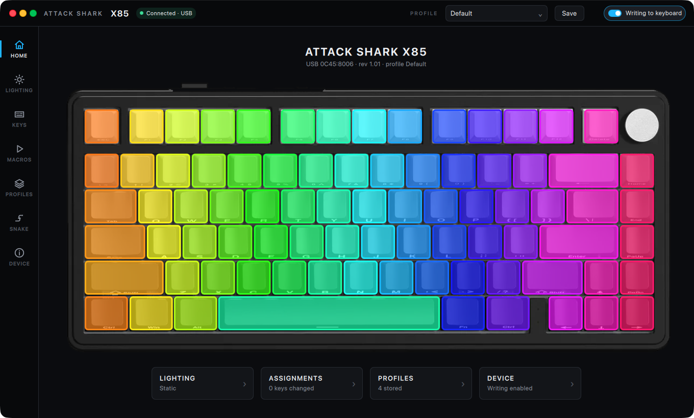
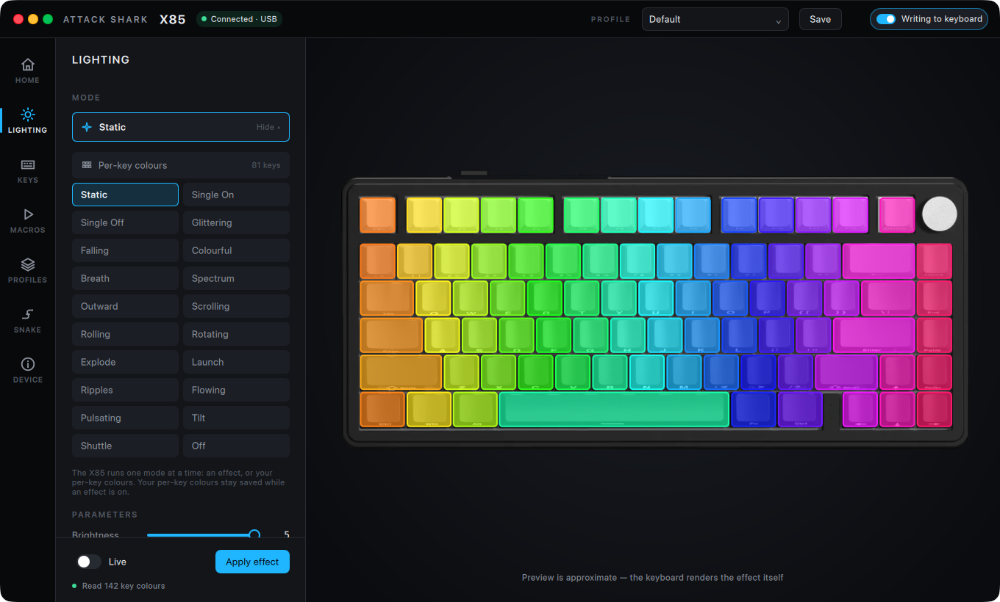
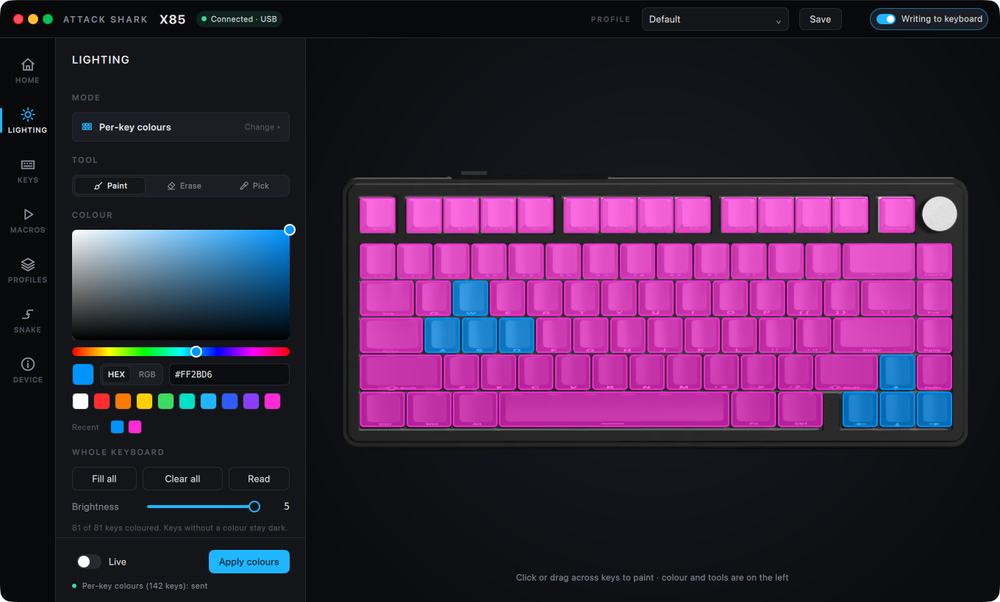
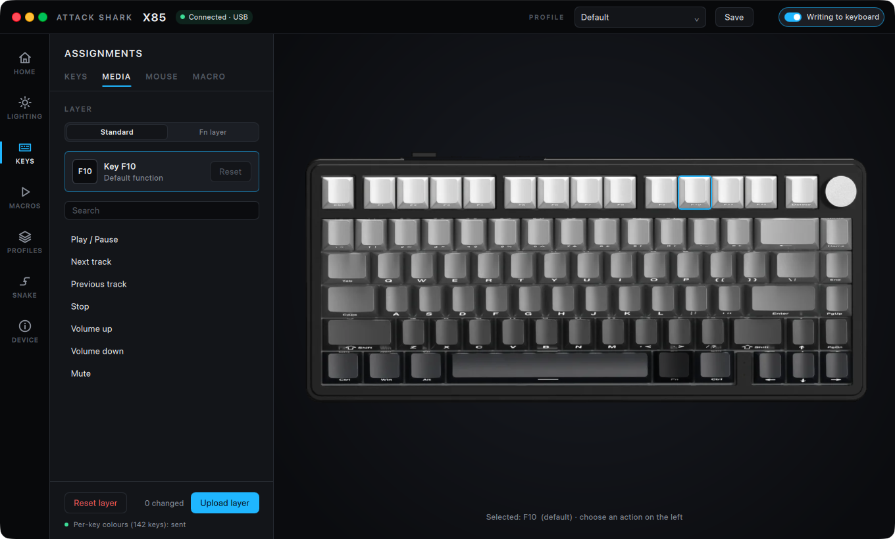
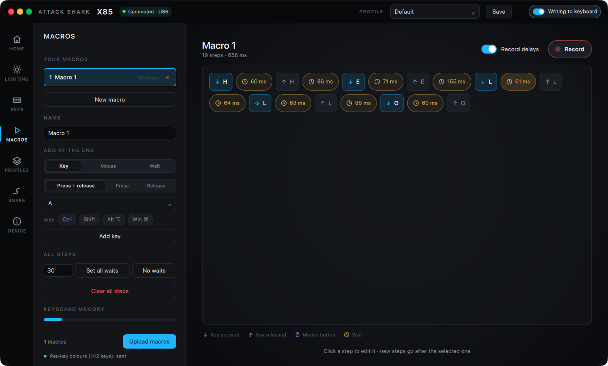
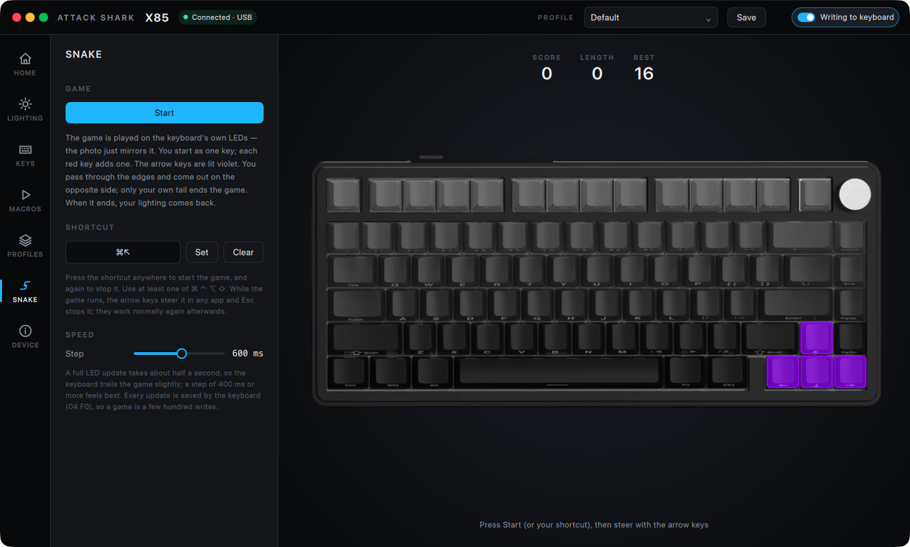

# ATTACK SHARK Control Center

An unofficial, native configuration app for the **ATTACK SHARK X85** keyboard (SONIX `0C45:8006`). It replaces the vendor's Windows-only software on macOS and is built so Windows and Linux can follow.

C++20 · Qt 6 (QML / Qt Quick) · HIDAPI · CMake. No kernel driver, no daemon, no Input Monitoring permission.

<p align="center">
  
</p>

> **Not affiliated with ATTACK SHARK.** The protocol was reverse-engineered from the vendor's own software (static analysis only, nothing was executed) and is documented in [`docs/PROTOCOL.md`](docs/PROTOCOL.md). Use it at your own risk; the safety rules below exist for that reason.

---

## Contents

1. [Status](#1-status)
2. [Features](#2-features)
3. [Screenshots](#3-screenshots)
4. [Safety model](#4-safety-model)
5. [Quick start](#5-quick-start)
6. [Architecture](#6-architecture)
7. [Protocol in 60 seconds](#7-protocol-in-60-seconds)
8. [Subsystems in detail](#8-subsystems-in-detail)
9. [Data and settings on disk](#9-data-and-settings-on-disk)
10. [Testing](#10-testing)
11. [Verifying on real hardware](#11-verifying-on-real-hardware)
12. [Packaging](#12-packaging-macos)
13. [Developer aids](#13-developer-aids)
14. [Porting to Windows / Linux](#14-porting-to-windows--linux)
15. [Known limitations](#15-known-limitations)
16. [Repository layout](#16-repository-layout)

---

## 1. Status

Confidence tags used here and in `docs/PROTOCOL.md`: **[HW]** observed on hardware · **[RE]** read from the decompiled vendor code · **[INF]** inferred and not confirmed.

| Area | State |
|---|---|
| USB/HID discovery, hot-plug, report descriptor | working **[HW]** |
| Per-key colour table upload (`04 23`) and read-back (`04 F5`) | working **[HW]**; used daily by the author |
| Lighting effects (`04 13`): 19 effects + off, brightness, speed, direction, colour | implemented from **[RE]**; packets match the vendor app byte for byte |
| Keymap, base and Fn layer (`04 11` / `04 27`): keys + modifiers, media, mouse | implemented from **[RE]**, byte-exact tests; not confirmed on hardware |
| Macros (`04 15`) and binding keys to them (`06 idx mode count`) | implemented from **[RE]**, byte-exact tests; not confirmed on hardware. Only play mode "repeat" is proven; the other three are **[INF]** |
| Keyboard options (`04 17`) | decoded only partly → **disabled** in the UI |
| Firmware version / update | not part of the vendor protocol → not offered |
| Platforms | macOS (Apple Silicon) is the supported target. The code is portable; see [§14](#14-porting-to-windows--linux) |

The X85 has **no command to read back its effect, brightness, speed, keymap or settings**: the vendor app keeps those in its own database, and so does this one (profiles on disk). Only the per-key colour table can be read.

---

## 2. Features

- **Lighting**: 19 on-board effects with an animated preview, brightness / speed / direction, single colour or rainbow, and a native colour picker (drag, HEX or RGB entry, presets, recent colours).
- **Per-key colours**: paint, erase or pick on the photo of the real keyboard; fill all, clear, read back from the keyboard. A *Live* switch sends changes as you edit.
- **Colour accuracy**: per-channel gain (default FastLED `TypicalSMD5050`) and adjustable gamma, with a *Calibrate white* mode. Read-back colours are inverse-corrected so the editor shows what you chose.
- **Key assignments**: base and Fn layer; keys with modifiers, media keys, mouse buttons and wheel, macros.
- **Macros**: a visual timeline of key / mouse / wait steps; **record from your real keyboard** (keys are captured by position, so layouts and macOS's ⌘/⌃ swap do not matter), with the real delays between presses.
- **Profiles**: lighting + per-key colours + both keymap layers + macros, stored as JSON; autosave, *Save*, *Overwrite*, *Save as new*, import/export, and one-click *Send to keyboard*.
- **Snake** on the keyboard's own LEDs: the keys are the grid, arrows steer, apples add length, the screen edges wrap. A user-chosen system-wide shortcut starts/stops it; the previous lighting is restored afterwards.
- **Background mode (macOS)**: closing the window hides it; the app keeps running from a menu-bar icon (profile switcher, status, open, quit). Optional Dock icon.
- **Native macOS integration**: frameless window with traffic lights in the app's own top bar, native menu bar (Keyboard / Go / Games / Window), system-wide hotkeys that need no permissions.

---

## 3. Screenshots

| | |
|---|---|
|  **Lighting: effects.** One mode list, parameters below. |  **Lighting: per-key.** Paint on the photo; HEX/RGB picker. |
|  **Assignments.** Keys, Media, Mouse, Macro tabs; standard and Fn layer. |  **Macros.** Timeline editor with keyboard recording. |


**Snake** on the real LEDs. The arrow keys are lit violet as the controls hint.

---

## 4. Safety model

These rules came with the project and are enforced in code, not just documented.

1. **Writes are off by default.** The top-bar switch *Writing to keyboard* (also in *Device*) gates every `SetFeature`. `DeviceManager::submit()` refuses all writes while it is off. Reads (`04 F5` + `04 02`, descriptors, enumeration) change nothing and are always allowed.
2. **No invented commands.** Every packet is built by `CommandBuilder` from layouts read out of the vendor binary. Anything not decoded (keyboard options, clock, screen, firmware) is either disabled or absent. The *Sharkfin* family opcodes (`0x8F`, `0x07`, …) belong to a different protocol and are never sent.
3. **Packet-exact tests.** `tests/protocol` compares every transaction byte by byte with what the vendor code produces.
4. **Never touch the bootloader or firmware.** There is no code path for either.
5. **Do not take the keyboard away from macOS.** Only the vendor collection (usage page `0xFF13`) is opened, non-exclusively. The standard keyboard collections stay with the OS.
6. **Tools never hit the hardware by accident.** `x85ctl` prints packets and sends nothing without `--send`. Snapshot/screenshot runs (`KCC_SNAPSHOT_DIR`) refuse to write profiles or settings and never register system hotkeys.
7. **No unverified feature is presented as working.** Where the protocol is only partly known (macro play modes) the UI says so.

---

## 5. Quick start

Requirements: macOS 13+, Apple Silicon or Intel, Homebrew.

```bash
scripts/install-deps-macos.sh      # brew: cmake ninja pkg-config qt hidapi
scripts/build.sh                   # configure + build + run unit tests
open "build/ATTACK SHARK Control Center.app"
```

Manual configure:

```bash
cmake -S . -B build -G Ninja -DCMAKE_BUILD_TYPE=Release -DCMAKE_PREFIX_PATH="$(brew --prefix qt)"
cmake --build build
ctest --test-dir build --output-on-failure
```

CMake options: `KCC_BUILD_TESTS` (default `ON`). Qt ≥ 6.5 is required; the project is developed against Homebrew Qt 6.9.

On first start the app is read-only. Plug the keyboard in (USB cable; the 2.4 GHz dongle `05AC:024F` is not supported), check the *Connected · USB* badge, then switch on *Writing to keyboard* when you want to change something.

---

## 6. Architecture

```
┌───────────────────────────── QML (ui/qml) ────────────────────────────┐
│ Main · LightingStudio · KeyMapping · MacroStudio · Profiles · Snake … │
│ context properties: Device Lighting KeyMap Macros Recorder Snake      │
│                     ProfileStore Shell KbLayout                       │
└──────────────┬────────────────────────────────────────────────────────┘
               │ Q_PROPERTY / Q_INVOKABLE
┌──────────────▼──────────────── services (main thread) ────────────────┐
│ LightingService  KeyMappingService  MacroService  ProfileService      │
│ KeyRecorder  SnakeGame  AppShell        ColorCorrection (header)      │
└──────────────┬────────────────────────────────────────────────────────┘
               │ Transaction (QVector<Packet>)   built by CommandBuilder
┌──────────────▼──────────────── core ──────────────────────────────────┐
│ DeviceManager  ── coalescing slots, write gate, log, state             │
│      │ queued call                                                     │
│ DeviceConnection (worker QThread) ── TransactionRunner (pacing/retry)  │
└──────────────┬────────────────────────────────────────────────────────┘
               │ HidTransport (abstract)
┌──────────────▼────────────────────────────────────────────────────────┐
│ HidDevice (hidapi) · DeviceDiscovery (VID/PID + usage page)            │
└────────────────────────────────────────────────────────────────────────┘
```

**Threading.** All services and QML live on the main thread. Hardware I/O happens only on the `DeviceConnection` worker thread, which owns the `HidDevice`. `DeviceManager` is the single door between them.

**Transactions.** A `Transaction` is a list of `Packet{64 bytes, readReply}`. `CommandBuilder` is the only place that knows the byte layout. `TransactionRunner` sends each packet with the vendor app's pacing (35 ms between packets), reads the reply where the vendor does, resends on a `0xFF` busy status, and aborts the transaction on the first hard failure.

**Coalescing.** `DeviceManager::submit(tx, label, coalesceKey)` keeps one slot per key (`lighting`, `keymap0`, `keymap1`, `macros`, `snake`). A newer submit replaces a transaction that is queued but not yet started, so dragging a slider or painting never builds a backlog of stale writes. The worker always runs the latest state.

**Live updates.** `LightingService::liveApply` debounces edits (250 ms), de-duplicates identical byte sequences, and, once the board is in user mode `0x80` with the same brightness, sends only the `04 23` table instead of the full sequence. That avoids the visible blink caused by re-sending the mode switch. Explicit *Apply* always sends the complete vendor sequence.

**Portability seams.** Platform code is isolated behind small interfaces: `HidTransport`, `GlobalHotkeys`, `Tray`, `WindowChrome`. Each has a macOS implementation (`.mm`) and a stub.

---

## 7. Protocol in 60 seconds

Full detail, function addresses and confidence tags: [`docs/PROTOCOL.md`](docs/PROTOCOL.md).

- **Transport**: HID **feature reports** on the vendor collection, usage page `0xFF13` / usage `0x0001`, 64 bytes, no report ID. (hidapi prepends `0x00`.)
- **Packet**: `04 <cmd> <b2> 00 00 00 00 00 <pages> 00 …`
- **Write transaction**:

```
04 18                    begin   (04 19 for macros)
04 <cmd> … [8]=N         header, N = number of 64-byte data pages
N × 64 bytes             data, last two bytes of the block = AA 55
04 02                    end
04 F0                    apply / save   (lighting, per-key, keymap; not settings or macros)
```

| Cmd | Purpose | Data |
|---|---|---|
| `0x13` | Lighting mode: `[mode, R, G, B, …, colourful, brightness, speed, direction]`, `AA 55` at 14–15 | 1 page |
| `0x23` | Per-key colours: 144 slots × `[light_index, R, G, B]`, `AA 55` at 574 | 9 pages |
| `0x11` / `0x27` | Keymap, base / Fn layer: 144 slots × 4 bytes at `key_index*4` | 9 pages |
| `0x15` | Macro table: 100-entry index + bodies of 4-byte events | N pages |
| `0xF5` | **Read** per-key colours | 9 × GetFeature |

Lighting modes: `0` off, `1` static, `2`–`19` effects, `0x80` **user mode** (shows the per-key table). Brightness and speed are 0–5.

Keymap slot kinds: `02 mods usage 00` key · `03 lo hi 00` consumer · `01 01 btn 00` mouse · `01 03 delta 00` wheel · `06 idx mode count` macro · `00 00 00 00` default.

Macro event: `[delay_lo, delay_hi, usage, type]`, type `B0` key down · `30` key up · `90` mouse down · `10` mouse up · `50` delay (≥ 10 ms).

Timing: one per-key upload is 13 packets × 35 ms ≈ 0.5 s. That is the floor for any live effect, including Snake.

---

## 8. Subsystems in detail

### 8.1 Colour pipeline (`src/services/ColorCorrection.h`)

```
out = 255 · gain_c · (in / 255) ^ γ        (per channel, a lit channel never rounds to 0)
```

Defaults: γ = 1.0, gains `1.00 / 0.69 / 0.94` (FastLED `TypicalSMD5050` = `0xFFB0F0`). γ = 2.2 was the first default, but it crushed dim channels so blue→violet gradients collapsed to plain blue on the board. `invert()` undoes it for colours read back with `04 F5`. Settings are stored with a version key so an old γ = 2.2 value is dropped once.

### 8.2 Reading the keyboard

On connect `LightingService` reads `04 F5` (never in snapshot runs). The table is kept **separately** from your profile (`deviceColors`) and drawn on the photo only in per-key mode, until you edit. It is imported into the editor/profile only when you press *Read*. A connect-time read must not overwrite a saved preset, and during an effect the board returns a frozen frame of the animation, not a meaningful palette.

### 8.3 Profiles (`ProfileService`, `ProfileRepository`)

A profile is one JSON file: `lighting` (mode, parameters, `perKey`, `perKeyActive`), `keymap` (`base`, `fn`, slots as hex), `macros`. Every edit schedules an 800 ms autosave into the active profile; switching profiles flushes first. *Send to keyboard* uploads, in order: macros (if any key uses them), lighting or per-key table, base keymap, Fn keymap.

### 8.4 Macros (`MacroService`, `KeyRecorder`)

`CommandBuilder::macros()` lays out the table exactly as the vendor code does: 100 × 4-byte index entries (`u16` offset, or `FF FF FF FF` for an empty macro), bodies at offset 400 with an 8-byte header, `pages = len/64 + (len%64 ? 2 : 1)`. It refuses tables larger than the vendor buffer (3584 bytes).

`KeyRecorder` installs an application event filter while recording, converts the macOS virtual key code (`QKeyEvent::nativeVirtualKey`) to a HID usage by position, ignores auto-repeat, records the delay since the previous event, and releases keys still held when you stop so a macro never leaves a key stuck.

### 8.5 Snake (`SnakeGame`)

The grid is built from `X85Layout`: left/right are neighbours within a row (wrapping), up/down pick the nearest key by centre in the adjacent row (wrapping top↔bottom). The game logic (`step()`, `turn()`) is separate from rendering and fully unit-tested. Each step renders a colour map and submits `CommandBuilder::perKeyColors` (first frame with the mode switch, later frames table-only) under the coalesce key `snake`, so the LEDs trail the game by at most one transaction. On stop or game over the app re-applies the Lighting page's state. While a game runs, the arrow keys and Esc are registered as system-wide hotkeys (Carbon `RegisterEventHotKey`), so steering works in any app.

### 8.6 macOS shell

- **Window chrome** (`src/ui/platform/WindowChromeMac.mm`): Qt 6.9.0 ignores its own expanded-client-area hint on macOS, so the title bar is made transparent through AppKit (`FullSizeContentView`), the traffic lights are re-centred in the app's 52 px top bar, and re-applied on resize, key/main changes, screen changes, full-screen exit and every window update. The Qt window padding is zeroed.
- **Tray** (`TrayMac.mm`): an `NSStatusItem` with a template icon, a status line, a profile list (selecting one loads **and** sends it) and Open / Quit. The file is built without ARC, so the status item is retained explicitly (it vanished otherwise). The red close button is re-targeted to hide the window; ⌘Q still quits.
- **Hotkeys** (`GlobalHotkeysMac.mm`): Carbon hot keys need no Accessibility or Input Monitoring permission.
- **Menu bar**: `Qt.labs.platform` `MenuBar` (native).

---

## 9. Data and settings on disk

Qt `AppDataLocation` / `QSettings`, organisation `KeyboardControlCenter`, application `Keyboard Control Center` (kept for compatibility, so profiles survive renames of the product).

| What | Where (macOS) |
|---|---|
| Profiles | `~/Library/Application Support/KeyboardControlCenter/Keyboard Control Center/profiles/*.json` |
| Settings | `~/Library/Preferences/com.keyboardcontrolcenter.Keyboard Control Center.plist` |

Settings keys: `device/writesEnabled`, `profiles/active`, `lighting/correction/*`, `snake/best`, `snake/hotkey/*`, `app/hideDockInBackground`.

---

## 10. Testing

```bash
ctest --test-dir build --output-on-failure
```

| Suite | What it checks |
|---|---|
| `test_commands` | byte-exact packets: lighting, per-key (with and without mode switch), keymap, settings, macro table and key slot, colour correction round-trip |
| `test_parser` | descriptor and reply parsing, colour-table decoding |
| `test_runner` | pacing, busy resend, read-back against a mock `HidTransport` |
| `test_profiles` | JSON profile storage, sanitising, import/export |
| `test_recorder` | key recording incl. held keys, delays, insert position |
| `test_snake` | wrapping grid, growth, self-collision, hotkey registration |

No test needs hardware. Tests that need a window system run with `QT_QPA_PLATFORM=offscreen`.

---

## 11. Verifying on real hardware

`build/x85ctl` prints the exact packets and **sends nothing unless you add `--send`**. Go step by step:

```bash
./build/x85ctl list                                   # read-only enumeration
./build/x85ctl descriptor                             # vendor collection report descriptor
./build/x85ctl get                                    # one read-only GetFeature
./build/x85ctl read-colors --send                     # 04 F5 read-back + 04 02
./build/x85ctl light 1 --color FF0000 --brightness 3 --send   # static red
./build/x85ctl light 11 --send                        # back to the factory default (Rolling)
./build/x85ctl fill 00FF80 --send                     # per-key: every key one colour
./build/x85ctl modes                                  # list lighting modes
```

In the app, *Device → HID traffic* shows every `SETF` / `GETF` with replies. Keymap and macro uploads are the next things to confirm: try one harmless binding (an unused key → a letter) or one one-key macro before trusting larger ones.

---

## 12. Packaging (macOS)

```bash
scripts/package-macos.sh        # → dist/ATTACK SHARK Control Center.app and dist/ATTACK-SHARK-Control-Center.dmg
CODESIGN_ID="Developer ID Application: …" scripts/package-macos.sh   # sign
```

The script deploys into a **copy** in `dist/`, never into `build/` (a deployed `build/` mixes bundled and Homebrew Qt). It then repairs what Homebrew's `macdeployqt` misses: unresolved `@rpath` frameworks and dylibs (iterated to a fixed point), absolute `/opt/homebrew` references, rpaths into Homebrew, framework ids; it **fails** if anything still points outside the bundle, ad-hoc signs, verifies, launches the bundle once with `--kcc-smoke-test` (exit 0 = all libraries, plugins and QML modules resolve), and only then builds the `.dmg`.

The app icon is built from the vendor's logo (`ui/assets/icon/logo.svg`) and shipped as `AppIcon.icns`; the menu-bar icon is a template image (`tray.png`).

---

## 13. Developer aids

All are environment variables; none change the app for normal users.

| Variable | Effect |
|---|---|
| `KCC_SNAPSHOT_DIR=/path` | render every page to PNG and exit (use with `QT_QPA_PLATFORM=offscreen`). Never writes profiles/settings, never grabs hotkeys, never reads the keyboard |
| `KCC_SNAPSHOT_HEIGHT`, `KCC_SNAPSHOT_THEME` | window height / theme for snapshots |
| `KCC_SNAPSHOT_PERKEY`, `KCC_SNAPSHOT_MACRO`, `KCC_SNAPSHOT_SNAKE` | load demo data into the snapshot |
| `KCC_CHROME_DEBUG` | log title-bar geometry and hit tests |
| `KCC_FS_TEST` | enter and leave full screen automatically |
| `KCC_HIDE_TEST` | hide to tray after 3 s, show after 7 s |
| `--kcc-smoke-test` (argument) | load the QML and exit 0/1 |

---

## 14. Porting to Windows / Linux

Already portable: protocol, transaction runner, services, QML UI, profiles, tests, hidapi. To port, implement:

| Seam | File(s) | Notes |
|---|---|---|
| Window chrome | `src/ui/platform/WindowChromeOther.cpp` | currently a no-op; the regular frame is kept |
| Tray + hide-on-close | `src/ui/platform/TrayOther.cpp` | `QSystemTrayIcon` (Qt Widgets) or a native API |
| Global hotkeys | `src/platform/GlobalHotkeysOther.cpp` | `RegisterHotKey` (Windows), X11/portal (Linux). Key codes are macOS virtual codes today |
| Key recording | `KeyRecorder.cpp` | add the Windows/Linux native-code → HID table (the Qt-key fallback already works without left/right modifiers) |
| Packaging | new script | `windeployqt` / AppImage |

---

## 15. Known limitations

- Keymap and macro writes are decoded and tested but **not yet confirmed on a real keyboard**; macro play modes other than "repeat" are inferred.
- A live update costs ≈ 0.5 s (13 packets × 35 ms, a vendor setting). Snake and *Live* painting trail accordingly. Every table update also triggers the vendor's `04 F0` save, so long sessions mean many flash writes.
- Effect, brightness, speed and keymap **cannot be read** from the keyboard. If you change them with the keyboard's own Fn shortcuts, the app does not know; after a Snake game the app re-applies *its* idea of the lighting.
- Only the wired connection is supported.
- System-wide shortcuts and the tray are macOS-only for now. Hotkeys cannot use `Fn` (handled in the keyboard's firmware).
- Qt 6.9.0 on macOS needs the AppKit workarounds described in [§8.6](#86-macos-shell); newer Qt versions may make some of them unnecessary.

---

## 16. Repository layout

```
CMakeLists.txt
docs/PROTOCOL.md          full protocol write-up with Ghidra function addresses
docs/screenshots/         images used by this README
scripts/                  install-deps-macos.sh · build.sh · package-macos.sh
src/main.cpp              wiring, background mode, developer aids
src/core/                 DeviceManager, DeviceConnection (worker thread), TransactionRunner, DeviceInfo
src/hid/                  HidTransport (abstract), HidDevice (hidapi), DeviceDiscovery
src/protocol/             X85Protocol (constants/modes), CommandBuilder, ProtocolParser, X85Layout
src/services/             Lighting, KeyMapping, Macro, Profile, KeyRecorder, SnakeGame, AppShell, KeyCatalog, ColorCorrection
src/storage/              ProfileRepository (JSON), SettingsRepository (QSettings)
src/platform/             MacPlatform, GlobalHotkeys (+ macOS .mm / stub), windows/linux hooks
src/ui/platform/          WindowChrome, Tray (+ macOS .mm / stubs)
src/ui/viewmodels/        KeyboardLayoutModel (key geometry for QML)
ui/qml/                   Main, Workspace, KeyboardStage, LightingStudio, KeyMapping, MacroStudio, Profiles, SnakeGame, DeviceInfo, Dashboard + controls
ui/assets/                x85.png (keyboard photo), icon/ (logo.svg, AppIcon.icns, tray.png)
tests/                    protocol · hid · core
tools/x85ctl.cpp          CLI for hardware verification
```

## Licence

No licence has been chosen yet. Until one is added, all rights are reserved by the author. The vendor software, its name and its logo belong to their respective owners.
